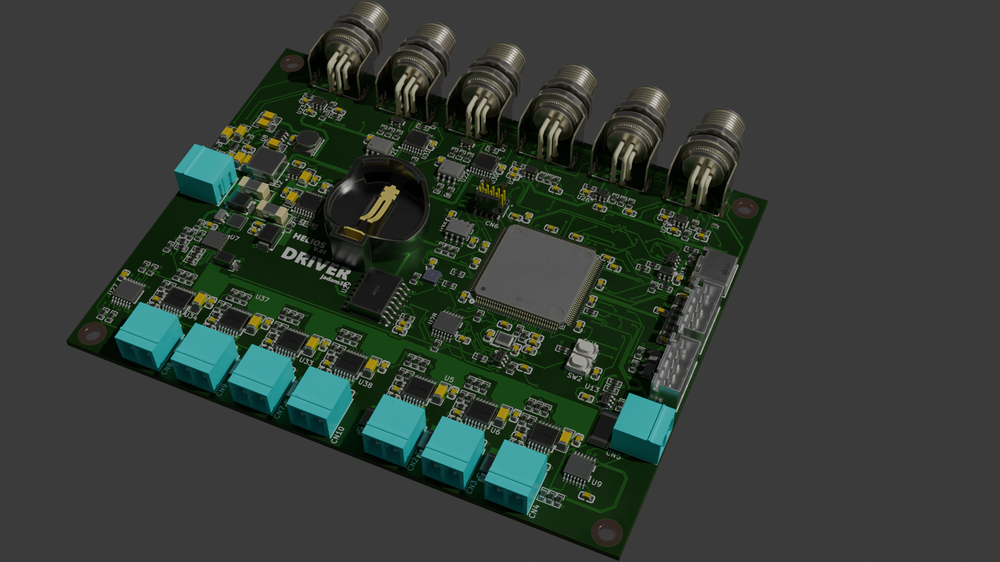

# Helios DRIVER2

I designed this board to run the watering system in my Helios greenhouse project. The four-layer board is about 117 × 91 mm and uses an STM32F429ZGT6. It switches four 12 V pumps, has three spare 12 V outputs, and takes up to six sensors through M8 connectors. My example firmware uses three sensors. You can change the code for your own setup as long as your sensors match the port voltages and interfaces.

The firmware builds in STM32CubeIDE. I still need to test it on the board with real sensors and pumps.

[System overview](../../README.md) · [Wiring and setup](../../docs/SETUP.md) · [MPPT board](../MPPT/README.md)

## Project files

| File or folder | What's inside |
| --- | --- |
| [DRIVER.kicad_pro](DRIVER.kicad_pro) | Open this in KiCad 10. The schematic, board and design rules are next to it. |
| [libs/](libs/) | Local symbols, footprints and 3D models. Keep this folder next to the KiCad project. |
| [Schematic PDF](docs/DRIVER.pdf) · [STEP model](docs/DRIVER.step) | Schematic and mechanical model. |
| [production/](production/) | Gerber ZIP, BOM CSV, component positions and other fabrication files. |
| [Interactive BOM](bom/ibom.html) | Find parts on the board. |
| [Filmware/](Filmware/) | STM32CubeIDE project, CubeMX configuration, C source and STM32 HAL. |
| [Filmware.elf](Filmware/artifacts/Filmware.elf) | Debug build. |
| [3D preview](media/helios-driver-3d.png) · [Video](media/helios-driver-preview.mp4) | Board preview and video. |

## Hardware

| Block | Parts and purpose |
| --- | --- |
| Power | 12 V DC input, separate feeds for logic and loads, and 5 V and 3.3 V rails. |
| Pumps and AUX | Four PUMP and three AUX outputs. Each uses a TPS1H100B-Q1 high-side switch and has a current-sense circuit. Check pump startup current, supply capacity, wiring and board temperature under load. |
| Sensors | Six M8 ports. SENS1–2 are analog, SENS3–4 are digital or pulse inputs, and SENS5–6 use THVD1410 RS-485 transceivers. Pin 1 supplies 5 V on SENS1–4 and 12 V on SENS5–6. |
| AO1 | 0–10 V analog output with an OPA197. |
| Clock and memory | Battery-backed DS3231 RTC and FM24W256 FRAM on I²C1. |
| Display and controls | 16×2 LCD1602 with a PCF8574T backpack on I²C2, a level shifter, and a separate three-button connector. |
| Debug and supervision | SWD, power status inputs, TPS3431 watchdog, TPS3808 reset supervisor and USB-C. |

### Pinout

| Connector | Pins |
| --- | --- |
| CN1 | 1 GND, 2 +12 V DC. |
| CN8 / CN9 / CN7 / CN10 | PUMP1 / PUMP2 / PUMP3 / PUMP4. Pin 1 GND, pin 2 switched +12 V. |
| CN2 / CN3 / CN4 | AUX1 / AUX2 / AUX3. Pin 1 GND, pin 2 switched +12 V. |
| CN5 | Pin 1 GND, pin 2 AO1. |
| CN6 SWD | 1 VTref 3.3 V, 2 SWDIO, 3/5/9 GND, 4 SWCLK, 6 SWO, 10 NRST. |
| U12 LCD | JST-XH B4B-XH-A. 1 +5 V, 2 GND, 3 SDA, 4 SCL. Match the wires to the labels on your LCD module. |
| U10 buttons | 1 GND, 2 START (PF14), 3 STOP (PF15), 4 manual watering (PG0). Each momentary button shorts its input to GND when pressed. |
| M8 SENS1–6 | 1 power, 2 SIG2, 3 GND, 4 SIG1. For RS-485, pin 2 is B and pin 4 is A on this board. |

## Firmware

[main.c](Filmware/Core/Src/main.c) handles watering, the LCD, RTC, FRAM, sensor readings and outputs. [buttons.c](Filmware/Core/Src/buttons.c) handles the three buttons. The pin assignments and peripheral settings are in [Filmware.ioc](Filmware/Filmware.ioc).

- **START** arms automatic watering. **STOP** takes priority. Hold the third button to run all four pumps manually.
- The controller checks the schedule at **07:00 and 19:00**. Between those times it can also start if the soil reads 35% or less for five samples, the temperature switch stays closed for about 5 seconds, or air humidity is 40% or less once that input is enabled. Daytime watering requires a valid soil reading below 55% and a 30-minute cooldown between runs.
- Automatic watering runs all four pumps and stops after three consecutive soil readings of at least 55%, if the soil reading goes stale, or after 60 seconds. A power fault shuts off the outputs.
- Before starting a scheduled run, the firmware saves the date in FRAM. The morning and evening slots have separate CRC-checked records so a restart won't repeat a run. PE3 keeps FRAM write protection high between writes.
- The LCD uses I²C address `0x27` (7-bit) and switches pages every 4 seconds. To try the AUX demo, set `aux_demo_request = 1` in the debugger while stopped. The three AUX outputs switch every 5 seconds. STOP or a power fault ends the demo. The example leaves AO1 and USB data unused.

### Sensors in my setup

| Measurement | Sensor and port | Connection |
| --- | --- | --- |
| Temperature threshold | KSD9700 NO 35°C on SENS3 (DIGITAL 1) | Dry contact between SIG1 (pin 4) and GND (pin 3). The STM32 reads it on PD9. |
| Soil moisture | JXCT JXBS-3001-TR-RS on SENS5 (RS485 1) | Modbus RTU, address 1, 9600 baud, 8N1, register `0x0002`. USART2 uses PD5 for TX, PD6 for RX and PD4 for direction. [JXCT manual](https://sourcewell.in/wp-content/uploads/2022/08/RS485-Soil-Temperature-and-Humidity-Sensor-JX-Instruction-Manual.pdf) |
| Air humidity | Ropam RHT-2H, EAN 5907565617733, on SENS1 (ANALOG 1) | RH-10V goes to SIG1 (pin 4). Power the sensor from a separate 12 V feed with a shared GND. [Ropam manual](https://ropam.com.pl/wsparcie/wp-content/uploads/2018/09/rht-2_i_pl.pdf) |

## Build and setup

Import [Filmware](Filmware/) as an existing STM32CubeIDE project and build it. Keep the `Core`, `Drivers`, linker scripts and IDE project files together. The peripheral configuration is [Filmware.ioc](Filmware/Filmware.ioc). The existing `Filmware` folder spelling is intentional so the saved paths keep working.

Program through CN6 SWD using the pinout above. Check the RTC date/time, LCD address, sensor configuration and STOP behaviour before connecting the actual pumps. The firmware has been built, but I still need to test the assembled board with its sensors and loads.

The example uses three sensor ports. The other ports remain available for your own code. `AIR_RH_ENABLED` is 0 in the supplied source; leave it off until the Ropam input's voltage scaling is suitable and calibrated. Read [system setup](../../docs/SETUP.md) before powering DRIVER2 from MPPT: that connection carries battery voltage.

## Bill of materials

[Original manufacturing BOM](production/bom.csv) · [Combined system BOM](../../BOM.csv)

The tables use direct supplier product links. Prices are USD per component at the stated quantity tier, checked on **November 19, 2026**. Costs use the required component quantities; the final cart can cost more because of minimum order quantities. Shipping, tax, fabrication and assembly are separate.

| References | Qty | Board value | Manufacturer part | Supplier | USD/part | Price tier |
| --- | ---: | --- | --- | --- | ---: | ---: |
| BT1 | 1 | BS-2-1 | BS-2-1 | [C2895401](https://jlcpcb.com/partdetail/BS-2-1/C2895401) | — | — |
| C1, C11, C23, C25, C39, C62, C63, C70, C71, C82, C88 | 11 | 1uF | CL10A105KB8NNNC | [C15849](https://www.lcsc.com/product-detail/C15849.html) | 0.0093 | 50 |
| C10, C12, C13, C2, C20, C24, C27, C31, C33, C34, C36, C37, C38, C40, C41, C42, C43, C44, C45, C46, C47, C48, C5, C53, C55, C57, C58, C59, C60, C65, C66, C67, C68, C69, C72, C73, C74, C75, C76, C79, C8, C80, C81, C87, C89, C9, C92, C93 | 48 | 100nF | CC0603KRX7R9BB104 | [C14663](https://www.lcsc.com/product-detail/C14663.html) | 0.0061 | 100 |
| C14, C15, C21, C22, C32, C35, C83, C84, C85, C86, C94, C95, C96, C97 | 14 | 10nF | CL10B103KB8NNNC | [C1589](https://www.lcsc.com/product-detail/C1589.html) | 0.0071 | 50 |
| C16, C17, C18, C19, C28, C29 | 6 | 22uF | CL31A226KAHNNNE | [C12891](https://www.lcsc.com/product-detail/C12891.html) | 0.1038 | 20 |
| C26, C3, C30, C4, C6, C7, C77, C78, C90, C91 | 10 | 10uF | CL31A106KBHNNNE | [C13585](https://www.lcsc.com/product-detail/C13585.html) | 0.1238 | 10 |
| C49, C51, C52, C61 | 4 | 10nF | 0603B103K500NT | [C57112](https://www.lcsc.com/product-detail/C57112.html) | 0.0064 | 100 |
| C50, C54 | 2 | 2.2uF | CL10A225KP8NNNC | [C1607](https://www.lcsc.com/product-detail/C1607.html) | 0.0203 | 50 |
| C56, C64 | 2 | 18pF | CL10C180JB8NNNC | [C1647](https://www.lcsc.com/product-detail/C1647.html) | 0.0139 | 50 |
| CN1 | 1 | 15EDGRC-3.81-02P | 15EDGRC-3.81-02P-14-00A(H) | [C507005](https://www.lcsc.com/product-detail/C507005.html) | 0.1261 | 5 |
| CN10, CN2, CN3, CN4, CN5, CN7, CN8, CN9 | 8 | 15EDGRC-3.81-02P-14-00A(H) | 15EDGRC-3.81-02P-14-00A(H) | [C507005](https://www.lcsc.com/product-detail/C507005.html) | 0.1261 | 5 |
| CN6 | 1 | FTSH-105-01-L-DV-K-TR | FTSH-105-01-L-DV-K-TR | [C448647](https://www.lcsc.com/product-detail/C448647.html) | 1.6301 | 1 |
| D1, D2 | 2 | SMBJ18CA | SMBJ18CA | [C83327](https://www.lcsc.com/product-detail/C83327.html) | 0.1636 | 5 |
| D10, D11, D12, D13, D3, D4, D5, D7 | 8 | SS56 | SS56 | [C65009](https://www.lcsc.com/product-detail/C65009.html) | 0.0511 | 10 |
| D6 | 1 | USBLC6-2SC6 | USBLC6-2SC6 | [C7519](https://www.lcsc.com/product-detail/C7519.html) | 0.1576 | 5 |
| D8, D9 | 2 | CDSOT23-SM712 | CDSOT23-SM712 | [C404012](https://www.lcsc.com/product-detail/C404012.html) | 0.5288 | 1 |
| E1, E2 | 2 | 14V | PESD5V0S1BL,315 | [C84374](https://www.lcsc.com/product-detail/C84374.html) | 0.0336 | 20 |
| F1 | 1 | 8A,65V | 0451020.MRL | [C178980](https://www.lcsc.com/product-detail/C178980.html) | 0.3797 | 5 |
| F2 | 1 | 2 A / 0451002.MRL. | 0451002.MRL | [C99547](https://www.lcsc.com/product-detail/C99547.html) | 0.2950 | 5 |
| L1 | 1 | FAUL0630 | FAUL0630-4R7MT | [C3040353](https://www.lcsc.com/product-detail/C3040353.html) | 0.3729 | 5 |
| L2 | 1 | FNR5040S3R9NT | FNR5040S3R9NT | [C167962](https://www.lcsc.com/product-detail/C167962.html) | 0.1062 | 10 |
| Q1 | 1 | CSD19537Q3 | CSD19537Q3 | [C478469](https://www.lcsc.com/product-detail/C478469.html) | 1.1567 | 1 |
| Q2, Q3, Q4 | 3 | BSS138-7-F | BSS138-7-F | [C40912](https://www.lcsc.com/product-detail/C40912.html) | 0.0443 | 10 |
| R1, R106, R107, R110, R111, R126, R127, R129, R130, R134, R135, R2, R3, R36, R37, R4, R46, R51, R52, R55, R61, R73, R82 | 23 | 4.7k | 0603WAF4701T5E | [C23162](https://www.lcsc.com/product-detail/C23162.html) | 0.0028 | 100 |
| R10, R102, R103, R104, R105, R117, R119, R12, R120, R121, R122, R123, R128, R140, R141, R142, R143, R15, R17, R18, R19, R25, R27, R28, R33, R41, R42, R48, R49, R50, R57, R59, R62, R63, R64, R65, R66, R74, R75, R80, R81, R83, R84, R86, R87, R89, R90, R95, R96, R97, R98, R99 | 52 | 10k | 0603WAF1002T5E | [C25804](https://www.lcsc.com/product-detail/C25804.html) | 0.0017 | 100 |
| R100, R101, R23, R93, R94 | 5 | 120k | 0603WAF1203T5E | [C25808](https://www.lcsc.com/product-detail/C25808.html) | 0.0016 | 100 |
| R108, R109, R11, R112, R113, R131, R132, R133, R136, R137, R34, R35, R38, R39, R5, R6, R7, R8 | 18 | 100k | 0603WAF1003T5E | [C25803](https://www.lcsc.com/product-detail/C25803.html) | 0.0030 | 100 |
| R114, R116 | 2 | 60.4k | ERJ2RKF6042X | [C2986234](https://www.lcsc.com/product-detail/C2986234.html) | 0.0064 | 100 |
| R115, R118, R13, R138, R139, R14, R40 | 7 | 470R | 0603WAF4700T5E | [C23179](https://www.lcsc.com/product-detail/C23179.html) | 0.0020 | 100 |
| R124, R125, R144, R145, R20, R21, R43 | 7 | 820R | 0603WAF8200T5E | [C23253](https://www.lcsc.com/product-detail/C23253.html) | 0.0015 | 100 |
| R16 | 1 | 12k | 0603WAF1202T5E | [C22790](https://www.lcsc.com/product-detail/C22790.html) | 0.0018 | 100 |
| R22 | 1 | 68k | 0603WAF6802T5E | [C23231](https://www.lcsc.com/product-detail/C23231.html) | 0.0016 | 100 |
| R24 | 1 | 8.2k | 0603WAF8201T5E | [C25981](https://www.lcsc.com/product-detail/C25981.html) | 0.0035 | 100 |
| R26 | 1 | 4.02 kΩ, ±1% | 0603WAF4021T5E | [C23040](https://www.lcsc.com/product-detail/C23040.html) | 0.0018 | 100 |
| R29, R32 | 2 | 750k | 0603WAF7503T5E | [C23240](https://www.lcsc.com/product-detail/C23240.html) | 0.0027 | 100 |
| R30 | 1 | 34.8k | 1RC0603F3482 | [C54531393](https://www.lcsc.com/product-detail/C54531393.html) | 0.0021 | 100 |
| R31 | 1 | 64.9k | 0603WAF6492T5E | [C14891](https://www.lcsc.com/product-detail/C14891.html) | 0.0029 | 100 |
| R44, R45 | 2 | 5.1k | 0603WAF5101T5E | [C23186](https://www.lcsc.com/product-detail/C23186.html) | 0.0015 | 100 |
| R47, R53, R54, R76, R85, R88 | 6 | 1KΩ | 0603WAF1001T5E | [C21190](https://www.lcsc.com/product-detail/C21190.html) | 0.0016 | 100 |
| R56 | 1 | 1M | 0603WAF1004T5E | [C22935](https://www.lcsc.com/product-detail/C22935.html) | 0.0018 | 100 |
| R58 | 1 | 22k | 0603WAF2202T5E | [C31850](https://www.lcsc.com/product-detail/C31850.html) | 0.0042 | 100 |
| R60 | 1 | 100R | 25121WF1000T4E | [C35218](https://www.lcsc.com/product-detail/C35218.html) | 0.0397 | 20 |
| R67 | 1 | 33k | 0603WAF3302T5E | [C4216](https://www.lcsc.com/product-detail/C4216.html) | 0.0021 | 100 |
| R68 | 1 | 82k | 0603WAF8202T5E | [C23254](https://www.lcsc.com/product-detail/C23254.html) | 0.0028 | 100 |
| R69, R70, R71, R72 | 4 | 10R | CRCW060310R0FKEAHP | [C313648](https://www.lcsc.com/product-detail/C313648.html) | 0.0388 | 20 |
| R77, R78 | 2 | 15k | 0603WAF1502T5E | [C22809](https://www.lcsc.com/product-detail/C22809.html) | 0.0029 | 100 |
| R79 | 1 | 0R0 | 0603WAF0000T5E | [C21189](https://www.lcsc.com/product-detail/C21189.html) | 0.0021 | 100 |
| R9 | 1 | 30k | 0603WAF3002T5E | [C22984](https://www.lcsc.com/product-detail/C22984.html) | 0.0021 | 100 |
| R91, R92 | 2 | 120R | 0603WAF1200T5E | [C22787](https://www.lcsc.com/product-detail/C22787.html) | 0.0020 | 100 |
| SW1, SW2 | 2 | SKRPACE010 | SKRPACE010 | [C139797](https://www.lcsc.com/product-detail/C139797.html) | 0.0670 | 10 |
| U1, U30, U31 | 3 | TPS26600PWPR | TPS26600PWPR | [C544399](https://www.lcsc.com/product-detail/C544399.html) | 1.5863 | 1 |
| U10, U12 | 2 | B4B-XH-A(LF)(SN) | B4B-XH-A(LF)(SN) | [C144395](https://www.lcsc.com/product-detail/C144395.html) | 0.0541 | 10 |
| U11, U33, U34, U37, U38, U5, U6 | 7 | TPS1H100BQPWPRQ1 | TPS1H100BQPWPRQ1 | [C475505](https://www.lcsc.com/product-detail/C475505.html) | 8.7646 | 1 |
| U13 | 1 | OPA197IDBVR | OPA197IDBVR | [C221351](https://www.lcsc.com/product-detail/C221351.html) | 0.7519 | 1 |
| U14 | 1 | STM32F429ZGT6 | STM32F429ZGT6 | [C46525](https://www.lcsc.com/product-detail/C46525.html) | 9.1754 | 1 |
| U15, U16, U17, U18, U19, U20 | 6 | M8-S4A-GPL M10-JD | M8-S4A-GPL M10-JD | [C19108970](https://www.lcsc.com/product-detail/C19108970.html) | 5.0907 | 1 |
| U2 | 1 | AP63205WU-7 | AP63205WU-7 | [C2071056](https://www.lcsc.com/product-detail/C2071056.html) | 0.4675 | 1 |
| U21, U22 | 2 | THVD1410DR | THVD1410DR | [C2671345](https://www.lcsc.com/product-detail/C2671345.html) | 2.8876 | 1 |
| U23, U24, U25, U26, U3 | 5 | TPS2553DBVR | TPS2553DBVR | [C55266](https://www.lcsc.com/product-detail/C55266.html) | 0.5618 | 1 |
| U27, U28, U9 | 3 | SN74HCS08QPWRQ1 | SN74HCS08QPWRQ1 | [C2867158](https://www.lcsc.com/product-detail/C2867158.html) | 0.5542 | 1 |
| U29 | 1 | DS3231 | DS3231SN#T&R | [C9866](https://www.lcsc.com/product-detail/C9866.html) | 8.2765 | 1 |
| U32 | 1 | TPS3431SDRBR | TPS3431SDRBR | [C702145](https://www.lcsc.com/product-detail/C702145.html) | 11.0243 | 1 |
| U35 | 1 | FM24W256-GTR | FM24W256-GTR | [C66020](https://www.lcsc.com/product-detail/C66020.html) | 4.2147 | 1 |
| U36 | 1 | TPS3808G33DBVR | TPS3808G33DBVR | [C43698](https://www.lcsc.com/product-detail/C43698.html) | 0.3917 | 5 |
| U4 | 1 | TPS2116DRLR | TPS2116DRLR | [C3235557](https://www.lcsc.com/product-detail/C3235557.html) | 0.3801 | 1 |
| U7 | 1 | TPS26631RGER | TPS26631RGER | [C1850273](https://www.lcsc.com/product-detail/C1850273.html) | 11.0144 | 1 |
| U8 | 1 | AP63203WU-7 | AP63203WU-7 | [C780769](https://www.lcsc.com/product-detail/C780769.html) | 1.3577 | 1 |
| USBC1 | 1 | TYPE-C-31-M-12 | TYPE-C-31-M-12 | [C165948](https://www.lcsc.com/product-detail/C165948.html) | 0.1888 | 5 |
| X1 | 1 | X32258MOB4SI | X32258MOB4SI | [C2682775](https://www.lcsc.com/product-detail/C2682775.html) | 0.1968 | 5 |

## Development and reuse

See [credits](../../CREDITS.md) for development assistance and dependencies. The STM32 HAL and CMSIS license files are kept with their source directories. A project-wide license has not been selected.
