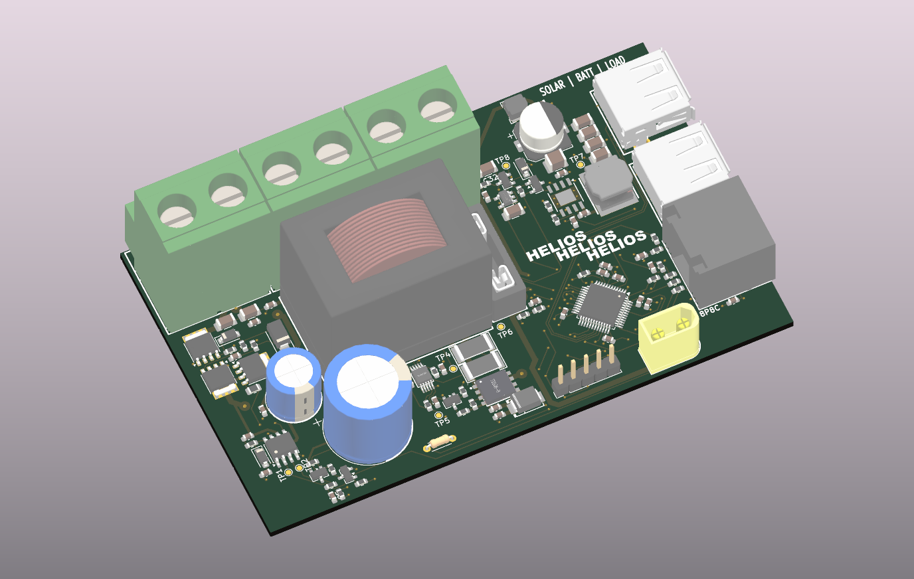

# Helios MPPT

Solar power board for the Helios greenhouse controller, using an STM32L072CZT6. The original schematic and PCB are preserved. The 8P8C connector is not used by the firmware.

[PCB view](media/helios-mppt-pcb.png) · [Board video](media/helios-mppt-preview.mp4) · [Schematic](docs/MPPT.pdf) · [STEP](docs/MPPT.step) · [Interactive BOM](bom/ibom.html)

## Current firmware

The complete firmware now includes actual power-stage PWM, voltage/current/temperature measurements, current and voltage limiting, output-power perturb-and-observe, Li-ion charge termination/restart, load hysteresis, latched faults, a control heartbeat and watchdog.

[Open the Arduino sketch](firmware/HeliosMPPT/HeliosMPPT.ino) · [All source files in one text source text](firmware/COMPLETE_SOURCE.txt) · [Full firmware ZIP](firmware/HeliosMPPT-full.zip) · [Setup and calibration](firmware/README.md) · [Build results](firmware/BUILD_RESULTS.txt)

Compiled successfully for Generic L072CZTx with STM32 Arduino core 3.1.0, in both the default and confirmed charging configurations, with no compiler warnings. Host tests passed 25 checks and exercised 88 duty settings in both timer directions. The assembled board and charger still need bench testing.

**Battery/calibration confirmation defaults to off.** After confirming a protected 3S Li-ion battery and calibrating sensors, set HELIOS_BATTERY_CONFIRMED and HELIOS_CALIBRATION_CONFIRMED to 1 in Config.h. The implemented charger then starts automatically after valid solar qualification. This is a 12.55 V / 2 A reference profile; it is not for AGM or 4S LiFePO4. TH1 beta remains an explicit calibration input.

The original AP2210 and LM5109B supply operating limits remain relevant. A 14.5 V AGM profile is not supported by the unchanged design. Default diode freewheeling raises low-side losses; the optional synchronous mode and actual MOSFET waveforms require bench checks. See the firmware instructions for the controls and limits.

## Hardware

| Block | Components | Purpose |
| --- | --- | --- |
| MCU | STM32L072CZTx, LQFP48 | ADC, DAC, GPIO and timer control; supported by the STM32 Arduino core |
| Converter | Q3–Q5 PSMN5R2-60YL, LM5109BMA, L1 CPEX3222L-470MC-RS | Solar input switching and synchronous buck stage |
| Current sensing | INA2181A1, two 3 mΩ shunts | Converter output current and load current; nominal sensitivity 60 mV/A |
| Voltage sensing | 100 kΩ / 5.6 kΩ dividers | Battery and solar voltage; divider ratio 18.857 |
| Temperature | TH1 10 kΩ NTC | Temperature input; its beta value is not specified in the design |
| Load switch | BSC084P03NS3 G, MMBT3904 | MCU-controlled battery/load output |
| Auxiliary power | LMR33630, AP2210K-3.3 | 5 V buck and 3.3 V LDO |
| Connections | Three screw terminals, XT30, two USB-A sockets, SWD | Power, loads and programming |

The XT30 output is on the unswitched load rail. Turning off LOAD_EN does not disconnect it or the 5 V buck. F2 is a fuse holder: the fitted fuse must be specified separately. Component headline current ratings do not establish the assembled board's continuous current rating.

## Connector and firmware pin map

| Connection | MCU / connector assignment |
| --- | --- |
| Solar U1 | Pin 2 SOLAR+, pin 1 SOLAR−; use the labeled input return |
| Battery U6 | Pin 1 BAT+, pin 2 GND |
| Switched load U5 | Pin 1 switched positive, pin 2 GND |
| XT30 U4 | Pin 1 LOAD_SOLAR, pin 2 GND |
| SWD J4 | 1 VTref 3.3 V, 2 SWCLK, 3 GND, 4 SWDIO, 5 NRST |
| Battery / panel voltage | PA0 / PA1 |
| Current reference DAC | PA4; approximately half VDDA |
| Load / converter current | PA5 / PA6 |
| NTC measurement / return | PA7 / PA8 |
| Driver HI / LI | PB0 / PB1; TIM3 CH3/CH4 PWM, LOW while stopped or unconfigured |
| Switched load enable | PC13; active-HIGH switched load with voltage hysteresis and fault shutdown |
| PV measurement enable | PC14; HIGH enables the divider, not the power converter |
| 5 V status | PC15; Q8 makes LOW mean power-good |
| 5 V buck enable | PB10 |

## Getting started

Open the Arduino sketch using [these firmware instructions](firmware/README.md). For the connections between both boards and the first hardware checks, see [system setup](../../docs/SETUP.md). The defaults leave charging off until the battery and calibration settings are confirmed.

## Project files

| Path | Contents |
| --- | --- |
| `MPPT.kicad_pro`, `.kicad_sch`, `.kicad_pcb` | Original KiCad project and source files |
| `libs/`, `fp-lib-table`, `sym-lib-table` | Required local symbols, footprints and models |
| `firmware/HeliosMPPT/` | Complete Arduino sketch, configuration, controller and PWM driver |
| `firmware/tests/` | Host C++ controller tests |
| `docs/` | Schematic PDF and STEP model |
| `media/` | Render, PCB image and original video |
| `MPPT.glb` | Interactive 3D model, kept beside the KiCad project export settings |
| `production/` | Existing manufacturing exports, preserved unchanged |
| `bom/` | Interactive BOM and a source-derived parts list with available links |

## Bill of materials

[Original manufacturing BOM](production/bom.csv) · [Expanded parts list](bom/parts-with-links.csv) · [Combined system BOM](../../BOM.csv)

The table describes the original board. Parts without an assigned supplier number still need an exact manufacturer part to be selected, including the necessary voltage, power and package ratings.

The tables use direct supplier product links. Prices are USD per component at the stated quantity tier, checked on **November 19, 2026**. Costs use the required component quantities; the final cart can cost more because of minimum order quantities. Shipping, tax, fabrication and assembly are separate.

| References | Qty | Board value | Manufacturer part | Supplier | USD/part | Price tier |
| --- | ---: | --- | --- | --- | ---: | ---: |
| C1 | 1 | 10nF | — | Not selected | — | — |
| C2, C21, C36 | 3 | 2.2uF | — | Not selected | — | — |
| C3, C6, C8, C26, C27, C28, C29, C30, C31, C34 | 10 | 100nF | — | Not selected | — | — |
| C4 | 1 | 1200uF | — | Not selected | — | — |
| C5, C10, C12, C15, C16, C17, C18, C20, C23, C38 | 10 | 10nF | — | Not selected | — | — |
| C7 | 1 | 4.7uF | — | Not selected | — | — |
| C9, C11, C13 | 3 | 1nF | — | Not selected | — | — |
| C14 | 1 | 820uF | — | Not selected | — | — |
| C19 | 1 | 1uF | — | Not selected | — | — |
| C22 | 1 | 150uF | — | Not selected | — | — |
| C24 | 1 | 10uF | — | Not selected | — | — |
| C25 | 1 | 220nF | — | Not selected | — | — |
| C32, C41 | 2 | 2.2uF | — | Not selected | — | — |
| C33, C35, C37, C39 | 4 | 22uF | — | Not selected | — | — |
| C40 | 1 | 100pF | — | Not selected | — | — |
| D1, D2, D5 | 3 | 1N4148W | — | Not selected | — | — |
| D3 | 1 | SS14 | — | Not selected | — | — |
| D4 | 1 | SMBJ24A_C123819 | SMBJ24A | [C123819](https://www.lcsc.com/product-detail/C123819.html) | 0.0593 | 10 |
| F2 | 1 | 3557-2 | 3557-2 | [C352820](https://www.lcsc.com/product-detail/C352820.html) | 1.4802 | 1 |
| J4 | 1 | Conn_01x05 | — | Not selected | — | — |
| L1 | 1 | CPEX3222L-470MC-RS | CPEX3222L-470MC-RS | [C53145486](https://www.lcsc.com/product-detail/C53145486.html) | 5.0594 | 1 |
| L2 | 1 | 2.2uH | — | Not selected | — | — |
| L3 | 1 | SRN8040TA | SRN8040TA-100M | [C2044906](https://www.lcsc.com/product-detail/C2044906.html) | 0.7615 | 1 |
| Q2, Q8, Q9 | 3 | BSS83P | — | Not selected | — | — |
| Q3, Q4, Q5 | 3 | PSMN5R2-60YL | — | Not selected | — | — |
| Q6, Q7 | 2 | MMBT3904 | — | Not selected | — | — |
| Q10 | 1 | BSC084P03NS3 G | BSC084P03NS3GATMA1 | [C672354](https://www.lcsc.com/product-detail/C672354.html) | 1.1136 | 1 |
| R1, R17, R18, R25 | 4 | 10k | — | Not selected | — | — |
| R2, R24 | 2 | 24.9k | — | Not selected | — | — |
| R3, R4, R10, R21, R22, R23, R30 | 7 | 100k | — | Not selected | — | — |
| R5, R11 | 2 | 5.6k | — | Not selected | — | — |
| R6 | 1 | 1M | — | Not selected | — | — |
| R7, R9, R27, R29 | 4 | 470 | — | Not selected | — | — |
| R8, R13 | 2 | 4R7 | — | Not selected | — | — |
| R12 | 1 | 4R7 | — | Not selected | — | — |
| R14, R19 | 2 | 3mR | CRE2512-FZ-R001E-3 | [C840615](https://www.lcsc.com/product-detail/C840615.html) | 0.4295 | 1 |
| R15, R26, R28, R31 | 4 | 2.2k | — | Not selected | — | — |
| R16 | 1 | 2R2 | — | Not selected | — | — |
| R20 | 1 | 100 | — | Not selected | — | — |
| RJ1 | 1 | HX-RJ45 90 5631-1X1 8P8C S | HX-RJ45 90 5631-1x1 8P8C S | [C25168872](https://www.lcsc.com/product-detail/C25168872.html) | 0.1430 | 5 |
| TH1 | 1 | 10K NTC | — | Not selected | — | — |
| TP1 | 1 | PWM_HS_TP | — | Not selected | — | — |
| TP2 | 1 | PWM_LS_TP | — | Not selected | — | — |
| TP3 | 1 | REF_TP | — | Not selected | — | — |
| TP4 | 1 | DCDC_CURRENT_TP | — | Not selected | — | — |
| TP5 | 1 | LOAD_CURRENT_TP | — | Not selected | — | — |
| TP6 | 1 | 12VTP | — | Not selected | — | — |
| TP7 | 1 | 5V_TP | — | Not selected | — | — |
| TP8 | 1 | 3.3V_TP | — | Not selected | — | — |
| U1, U5, U6 | 3 | KF135T-10.16-2P | KF135T-10.16-2P | [C475108](https://www.lcsc.com/product-detail/C475108.html) | 0.5699 | 1 |
| U2 | 1 | INA2181A | INA2181A1IDGSR | [C1848164](https://www.lcsc.com/product-detail/C1848164.html) | 0.5701 | 1 |
| U3 | 1 | LM5109BMA | LM5109BMA/NOPB | [C1549317](https://www.lcsc.com/product-detail/C1549317.html) | 1.0736 | 1 |
| U4 | 1 | XT30AW-M.G.Y | XT30AW-M.G.Y | [C19268026](https://www.lcsc.com/product-detail/C19268026.html) | 0.4097 | 1 |
| U7 | 1 | STM32L072CZTx | STM32L072CZT6 | [C1337587](https://www.lcsc.com/product-detail/C1337587.html) | 5.9667 | 1 |
| U8 | 1 | LMR33630 | LMR33630ADDA | [C2866787](https://www.lcsc.com/product-detail/C2866787.html) | 1.0284 | 1 |
| U9 | 1 | AP2210K-3.3TRG1 | AP2210K-3.3TRG1 | [C176959](https://www.lcsc.com/product-detail/C176959.html) | 0.1626 | 5 |
| USB1, USB2 | 2 | USB-231-ARY | USB-231-ARY | [C720525](https://www.lcsc.com/product-detail/C720525.html) | 0.1971 | 5 |

U3, U7 and U8 use catalog references added to the documentation; they do not change the schematic or manufacturing files. Codes recovered from footprint names still need a part/package check before an order.

## Development and reuse

This is part of my Helios greenhouse project. See [development credits](../../CREDITS.md) for assistance and third-party dependencies. A project-wide license has not been selected.
