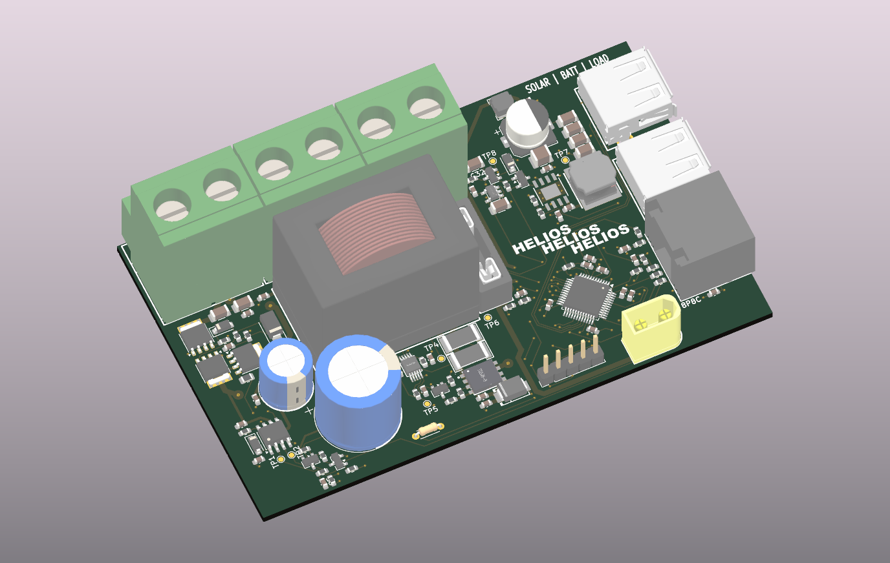
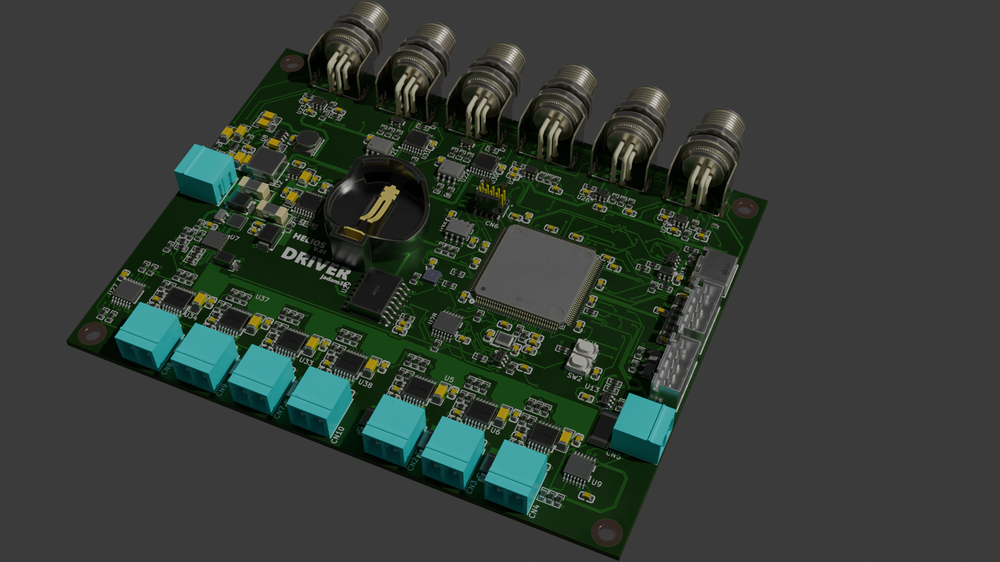
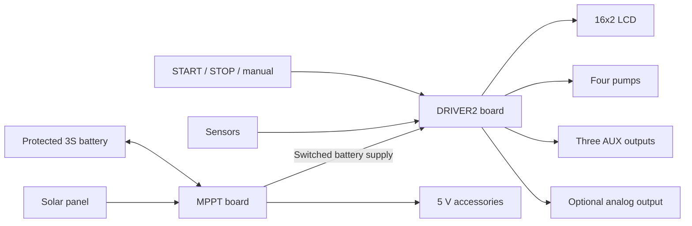

# Helios

I'm 17 and I'm building a solar-powered watering system for a greenhouse. Helios has two custom boards: **MPPT** handles the power side, and **DRIVER2** handles the pumps, sensors, screen and buttons. I wanted a project where I could learn PCB design and embedded programming while making something useful for growing plants.

The repository includes the KiCad projects, local libraries, firmware, manufacturing files, BOMs and board previews. The watering rules are an example for my setup. You can change the code to suit different sensors or watering zones, after checking their electrical requirements.

| MPPT | DRIVER2 |
| --- | --- |
|  |  |
| [Board documentation](Boards/MPPT/README.md) | [Board documentation](Boards/DRIVER2/README.md) |
| [Preview video](media/helios-mppt-preview.mp4) | [Preview video](media/helios-driver-preview.mp4) |

The images and videos show the CAD designs. I haven't tested the assembled system yet.

## Current progress

| Part | What's implemented | What's been checked |
| --- | --- | --- |
| DRIVER2 | Pump control, watering schedule, START/STOP/manual buttons, sensor handling, LCD, RTC and FRAM | Firmware previously built in STM32CubeIDE. Testing with real pumps and sensors is still needed. |
| MPPT | Measurements, actual PWM, current/voltage regulation, output-power P&O, charge completion/restart, switched-load control and watchdogs | Both configurations compiled for STM32L072CZ with Arduino STM32 core 3.1.0. The portable tests passed 25 checks and checked 88 PWM duty settings in both timer directions. Hardware tests are still needed. |

The supplied MPPT profile is for **protected 3S Li-ion**, with a **12.55 V charge target** and a **2 A converter-output limit**. Charging stays off until the battery and calibration confirmations in `Config.h` are set. Read the [firmware setup instructions](Boards/MPPT/firmware/README.md) before changing those settings. This profile is not for 12 V AGM or 4S LiFePO4 batteries.

## How the boards connect



Connect MPPT **U5 pin 1** to DRIVER2 **CN1 pin 2**, and MPPT **U5 pin 2** to DRIVER2 **CN1 pin 1**. DRIVER2 receives switched battery voltage, rather than a regulated 12 V supply. Check the operating voltage of the actual pumps, sensors and other loads across the battery's range. The MPPT XT30 output is on a separate, unswitched rail.

Each MCU runs its own firmware. There is no data connection between the two boards in this version. The 8P8C connector is unused and is not an Ethernet interface.

## Example watering behaviour

- START arms automatic watering. STOP takes priority. Holding the manual button runs all four pumps until it is released.
- The example checks scheduled watering at 07:00 and 19:00. It can also respond to dry soil, the temperature switch and air humidity when that input is enabled.
- Automatic watering runs all four pumps together. It stops when soil reaches the configured target, if soil readings go stale, on a fault, or after the 60-second runtime limit.
- The three AUX outputs have an optional five-second on/off demonstration. The analog output and USB data functions are unused in the example.
- My sensor setup uses a KSD9700 NO 35°C switch, a JXCT JXBS-3001-TR-RS soil sensor and a Ropam RHT-2H humidity sensor. The Ropam input is disabled in the supplied DRIVER2 code. Check the board instructions before enabling it.

The temperature switch only reports whether its threshold has been crossed. It doesn't return a temperature in degrees.

## What can be changed

DRIVER2 has four pump outputs, three AUX outputs, two analog sensor ports, two digital/pulse ports, two RS485 ports and an analog output. The RTC, FRAM, current-sense circuits, LCD and buttons can also be used by your own code.

For example, you could split watering into independent zones, add flow meters, use more Modbus sensors or write a local settings menu. Those are possible extensions, not features already included in the example. The MPPT code also exposes its measurements and operating state for debugging. Its optional UART2 telemetry requires access to PA2/PA3; no dedicated debug socket is fitted for those pins.

## Open and build

1. Open a board's `.kicad_pro` file in KiCad 10. Keep its local `libs/` folder and library tables next to it.
2. Import `Boards/DRIVER2/Filmware` into STM32CubeIDE to build the watering controller. The existing `Filmware` spelling is kept for compatibility with the project paths.
3. Open [HeliosMPPT.ino](Boards/MPPT/firmware/HeliosMPPT/HeliosMPPT.ino) in Arduino IDE 2. Install **STM32 MCU based boards 3.1.0**, select **Generic STM32L0 series → Generic L072CZTx**, and follow the [MPPT instructions](Boards/MPPT/firmware/README.md).
4. Follow [setup and wiring](docs/SETUP.md) for programming, configuration and the first hardware checks.

[Download the complete MPPT firmware](Boards/MPPT/firmware/HeliosMPPT-full.zip) · [Read all MPPT source files](Boards/MPPT/firmware/COMPLETE_SOURCE.txt) · [Build results](Boards/MPPT/firmware/BUILD_RESULTS.txt)

## Parts and cost

The [combined BOM](BOM.csv) includes both board lists and the external parts needed for an installation. Detailed tables are in the [DRIVER2 README](Boards/DRIVER2/README.md#bill-of-materials) and [MPPT README](Boards/MPPT/README.md#bill-of-materials). Both boards also keep their original manufacturing BOMs.

| Item | Quantity / cost status |
| --- | --- |
| DRIVER2 board components | 318 instances across 69 manufacturing-BOM rows |
| MPPT source components | 112 instances across 57 grouped rows, including test points |
| Priced subtotal | USD 185.5548, using priced rows from both boards, checked on November 19, 2026 |
| Full system cost | Incomplete: some MPPT parts, external devices, PCB fabrication, assembly, shipping and taxes are not priced |

The priced subtotal is not a full project quote. Missing costs are left blank or marked `n.a.` in the BOM. Some MPPT supplier selections are still missing. Final battery capacity, pump models, fuse selection and supplier quotes still need to be completed before ordering a full system.

## Power budget

Use actual measurements to size the panel and battery:

```text
Daily energy = standby power × 24 h + sum(load power × daily runtime)
Nominal battery energy = nominal battery voltage × capacity in Ah
```

As an example, 2 W standby plus four 6 W pumps running for ten minutes uses about **52 Wh/day**. A hypothetical 3S pack rated 11.1 V / 12 Ah stores about 133 Wh nominally. The usable energy is lower and depends on the cells, operating limits, temperature and losses. These numbers are examples, not measured Helios consumption or a final battery specification.

## Files

| Location | Contents |
| --- | --- |
| [Boards/MPPT/](Boards/MPPT/) | Power-board KiCad sources, libraries, firmware and documentation |
| [Boards/DRIVER2/](Boards/DRIVER2/) | Watering-controller KiCad sources, libraries and STM32CubeIDE project |
| [docs/SETUP.md](docs/SETUP.md) | Wiring, build and first-start instructions |
| [BOM.csv](BOM.csv) | Combined parts list and cost status |
| [CREDITS.md](CREDITS.md) | Development assistance and third-party dependencies |
| `media/` | Main renders and preview videos |

Source files are included for review and development. A project-wide license has not been selected. Third-party files keep their own license terms.

## A few thoughts at the end

I'm really happy with how Helios has turned out so far. This project taught me a lot about PCB design, power electronics and programming microcontrollers. It took a lot of hours, and there were plenty of things I had to learn along the way. Looking through the files now, it's nice to see how much work has come together. I hope it passes review and that the effort behind it comes through.

For anyone reviewing or analysing the project: I was given permission in **#PIXL-HELP** to use AI for translation. So yes, parts of the README and journals might have an "AI vibe" because AI helped translate them into English. I also received permission from staff in the same channel to write journals about the programming work. Development assistance is described in [CREDITS.md](CREDITS.md).

I also used AI to help create the 3D animations. Those animations were not included in my journals or counted towards my logged hours. The time spent preparing the BOM, writing the README and organising the project files was not included in my logged hours either.


